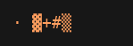
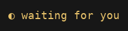
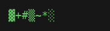
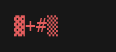
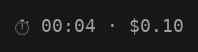

# dynacode

An OpenCode animation pack that makes the terminal TUI lively. Six subtle animations across the footers, the composer, and the sidebar — one text line each, driven by real session events, colored by your active theme.

## What animates

### Activity ribbon

The last thing the agent did, decoding in above the composer while it works. Driven by live session events: `starting` → `⚙ bash` → `reasoning` → `streaming`.



### Permission pulse

When OpenCode asks for permission, a rotating glyph beats in the prompt footer until you answer.



### Done flash

When a run finishes, the elapsed time scramble-decodes in green, holds ~2.4s, then vanishes.



### Fail flash

Failed and interrupted runs get the same decode-in, in red.



### Sidebar vitals

A live line at the bottom of the sidebar: run clock while working (session age otherwise) and the session's cost.



### Home footer

A six-bar equalizer waving under a phrase that types itself out, cycling every ~4s. Keeps the idle home screen alive.


All effects share one 90ms clock and your active theme's colors. Nothing reflows the layout.

## Requirements

- OpenCode V2 (tested on v2.3.2). TUI plugins resolve `@opencode/plugin/tui` and `solid-js` at runtime — no npm install, no build step.

## Install

**Option A — script:**

```powershell
.\install.ps1
```

**Option B — manual:** copy `index.ts` and `tui.tsx` into `~/.config/opencode/plugins/animation-pack/` (on Windows: `C:\Users\<you>\.config\opencode\plugins\animation-pack\`).

OpenCode watches its config directory and reloads plugins automatically. If the animations do not show up right away, run `/reload` inside the TUI.

## Usage

- `/anim` — toggle everything off/on (also `/anim on`, `/anim off`, or the command palette entry "Toggle animation pack"). The choice persists across restarts.

## Uninstall

Delete the `animation-pack` folder from `~/.config/opencode/plugins/`.

## Repository layout

| Path | Purpose |
|------|---------|
| `index.ts` | Server part of the plugin (identity only, no behavior) |
| `tui.tsx` | All animations: text effects, slots, event wiring, `/anim` command |
| `install.ps1` | Copies the plugin into the global OpenCode plugins directory |
| `tools/make_gifs.py` | Regenerates the GIFs above with the same math `tui.tsx` runs |
| `docs/*.gif` | README previews |

Regenerate previews with:

```sh
python tools/make_gifs.py
```

## Notes

- Assistant message text is rendered by OpenCode's own markdown pipeline, so a plugin cannot inject animation into it. This pack animates the surfaces plugins own: footer status rows, the composer ribbon, the sidebar footer, and toasts.
- Verified on OpenCode v2.3.2 with instrumented headless runs: clean plugin setup, every slot rendering live, stage events arriving from a real run, storage writes accepted. The GIFs were generated from a 1:1 port of the plugin's animation functions.
